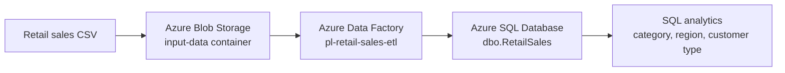

# Retail Sales ETL Pipeline on Microsoft Azure

A beginner-friendly data engineering portfolio project that ingests retail sales data from CSV in Azure Blob Storage, loads it into Azure SQL Database using Azure Data Factory, and analyses the results with SQL.

> **Project status:** Implemented and tested. The pipeline was validated and published, and the initial copy run succeeded with 15 rows copied and no reported errors.

## Project overview

This project demonstrates a simple cloud ETL workflow:

1. **Extract** — store a retail sales CSV file in a private Azure Blob Storage container.
2. **Transform / model** — use an Azure SQL table with a computed `TotalAmount` column (`Quantity * UnitPrice`).
3. **Load** — use Azure Data Factory Copy activity to move the CSV records into Azure SQL Database.
4. **Analyse** — use SQL queries to investigate sales by category, region, and customer type.

The current implementation uses a Copy activity for ingestion and SQL for analytical queries. It does not yet include a separate transformation activity, orchestration schedule, dashboard, or automated incremental loading.

## Architecture



## Azure resources

| Resource | Name / configuration |
|---|---|
| Resource group | `rg-azure-etl-project` |
| Azure Storage account | `stazureetlsomaan01` |
| Blob container | `input-data` (private) |
| Input file | `retail_sales.csv` |
| Azure Data Factory | `adf-retail-sales-somaan01` |
| Pipeline | `pl-retail-sales-etl` |
| Source dataset | `ds_retail_sales_csv` |
| Sink dataset | `ds_retail_sales_sql` |
| Azure SQL Database | `sqldb-retail-sales` |
| SQL table | `dbo.RetailSales` |
| Storage region | UK South |
| SQL database region | Australia East |
| Integration runtime | AutoResolveIntegrationRuntime (Australia East during the recorded run) |

**Note on regions:** Storage and SQL are in different Azure regions in this implementation. This was a practical choice for the initial learning project, but cross-region transfer can add latency and potentially data-transfer costs. For a production design, consider co-locating resources where feasible and appropriate.

## Source data

The CSV contains 15 sample retail sales records with these columns:

- `OrderID`
- `OrderDate`
- `Product`
- `Category`
- `Quantity`
- `UnitPrice`
- `Region`
- `CustomerType`

The source file is a small sample dataset intended for demonstrating the pipeline, not for making broad claims about real retail performance.

## SQL table

The destination table includes a computed column so SQL calculates each line's sales amount.

```sql
CREATE TABLE dbo.RetailSales (
    OrderID INT NOT NULL PRIMARY KEY,
    OrderDate DATE NOT NULL,
    Product NVARCHAR(100) NOT NULL,
    Category NVARCHAR(50) NOT NULL,
    Quantity INT NOT NULL,
    UnitPrice DECIMAL(10,2) NOT NULL,
    Region NVARCHAR(50) NOT NULL,
    CustomerType NVARCHAR(20) NOT NULL,
    TotalAmount AS (Quantity * UnitPrice) PERSISTED
);
```

The ADF Copy activity maps the eight CSV fields to the eight writable SQL fields. `TotalAmount` is intentionally not mapped because it is computed by SQL.

## Pipeline implementation

- **Pipeline:** `pl-retail-sales-etl`
- **Copy activity:** `CopyRetailSales`
- **Source:** Azure Blob Storage, `input-data/retail_sales.csv`
- **Sink:** Existing table `dbo.RetailSales` in Azure SQL Database
- **Write behavior:** Insert
- **Authentication:** Blob linked service uses account-key authentication; SQL linked service uses the Data Factory system-assigned managed identity.
- **SQL permissions:** The Data Factory managed identity was granted database write access and SELECT permission needed for schema import.

For production, prefer managed identity or other secure credential management wherever supported, restrict network access, store secrets securely, and grant only the permissions required.

## Validation and run results

The initial debug run returned:

| Metric | Result |
|---|---:|
| Rows read | 15 |
| Rows copied | 15 |
| Files read | 1 |
| Errors reported by Copy activity | 0 |
| Copy duration | 14 seconds |
| Data consistency verification | NotVerified |

An independent SQL query confirmed 15 rows in the table. The data consistency verification field from ADF was `NotVerified`, so SQL queries were used to check the destination data.

### Verification queries

```sql
SELECT
    COUNT(*) AS TotalRows,
    SUM(Quantity * UnitPrice) AS TotalSales
FROM dbo.RetailSales;
```

Recorded result:

| TotalRows | TotalSales |
|---:|---:|
| 15 | 1924.27 |

Inspect calculated amounts:

```sql
SELECT TOP 5
    OrderID,
    Product,
    Quantity,
    UnitPrice,
    TotalAmount
FROM dbo.RetailSales
ORDER BY OrderID;
```

## Business analysis

All figures below are based on the 15-row sample dataset and use the dataset's currency (not specified).

### Revenue by category

| Category | Units sold | Sales revenue |
|---|---:|---:|
| Monitors | 5 | 909.95 |
| Accessories | 26 | 774.38 |
| Peripherals | 6 | 239.94 |

**Observation:** Monitors produced the highest revenue (`909.95`), while Accessories had the highest unit volume (26 units).

SQL used:

```sql
SELECT
    Category,
    SUM(Quantity) AS UnitsSold,
    SUM(TotalAmount) AS SalesRevenue
FROM dbo.RetailSales
GROUP BY Category
ORDER BY SalesRevenue DESC;
```

### Revenue by region

| Region | Number of orders | Sales revenue |
|---|---:|---:|
| London | 4 | 743.95 |
| North West | 3 | 624.94 |
| Midlands | 3 | 299.94 |
| South East | 3 | 185.46 |
| Yorkshire | 2 | 69.98 |

**Observation:** London had the highest recorded revenue (`743.95`); Yorkshire had the lowest (`69.98`).

SQL used:

```sql
SELECT
    Region,
    COUNT(*) AS NumberOfOrders,
    SUM(TotalAmount) AS SalesRevenue
FROM dbo.RetailSales
GROUP BY Region
ORDER BY SalesRevenue DESC;
```

### Revenue by customer type

| Customer type | Orders | Units sold | Sales revenue | Average order value |
|---|---:|---:|---:|---:|
| Business | 7 | 17 | 1364.90 | 194.99 |
| Retail | 8 | 20 | 559.37 | 69.92 |

**Observation:** Business customers generated approximately 70.9% of revenue. Their average order value (`194.99`) was approximately 2.79 times the Retail average (`69.92`). Given the small sample size, these observations should be treated as illustrative, not conclusive.

SQL used:

```sql
SELECT
    CustomerType,
    COUNT(*) AS NumberOfOrders,
    SUM(Quantity) AS UnitsSold,
    SUM(TotalAmount) AS SalesRevenue,
    CAST(
        AVG(CAST(TotalAmount AS DECIMAL(10,2)))
        AS DECIMAL(10,2)
    ) AS AverageOrderValue
FROM dbo.RetailSales
GROUP BY CustomerType
ORDER BY SalesRevenue DESC;
```

## How to reproduce

1. Create an Azure resource group.
2. Create a Storage account and a private blob container named `input-data`.
3. Upload `retail_sales.csv` to that container.
4. Create an Azure SQL Database and create `dbo.RetailSales` using the DDL above.
5. Create an Azure Data Factory instance.
6. Configure a Blob Storage linked service and a CSV dataset pointing to `input-data/retail_sales.csv`; enable first-row-as-header.
7. Configure an Azure SQL linked service and grant its managed identity the required database permissions.
8. Create the pipeline `pl-retail-sales-etl` with a Copy activity named `CopyRetailSales`.
9. Map the eight CSV columns to the eight writable SQL columns. Do not map `TotalAmount`.
10. Validate, run a test load, inspect the run details, and verify the destination with SQL.
11. Publish the pipeline.

Exact authentication, firewall, networking, and pricing choices depend on the Azure subscription and environment.

## Important operational notes

- The sink uses **Insert**. Re-running the same CSV against a table whose `OrderID` is a primary key will likely fail with duplicate-key errors. Do not repeatedly trigger the pipeline unless you have deliberately implemented an idempotent loading strategy (for example, truncate-and-reload for a disposable demo table, staging plus `MERGE`, or a proper incremental load).
- The current pipeline is manually run; no schedule trigger is configured.
- The ADF run's reported Azure Integration Runtime billable duration was `0.0667 DIU-hours` for this copy activity. This is a run metric, not a monetary estimate. Check current Azure pricing and your subscription's free allowances before expanding the project.
- Keep public access disabled on the blob container. Review storage firewall/network settings and SQL firewall rules before using real data.
- Never commit passwords, access keys, connection strings, or other secrets to GitHub.

## Potential improvements

1. Add a staging table and implement safe repeatable loads.
2. Add data-quality checks (nulls, duplicate `OrderID`, invalid quantities/prices).
3. Parameterise the source filename and container path.
4. Add incremental loading based on `OrderDate` or a reliable watermark.
5. Create a Power BI report for category, region, and customer-type trends.
6. Add a CI/CD workflow and separate development/production environments.
7. Add monitoring and failure notifications.
8. Reconsider region placement to reduce cross-region latency and transfer costs where practical.

## Skills demonstrated

- Azure Blob Storage
- Azure Data Factory
- Azure SQL Database
- ETL pipeline design
- Managed identity and database permissions
- SQL aggregation and business analysis
- Data validation and pipeline troubleshooting
- Cloud resource and cost awareness

##  Repository structure

```text
azure-retail-sales-etl/
├── README.md
├── sql/
│   ├── create_table.sql
│   ├── validation_queries.sql
│   └── analytics_queries.sql
└── docs/
    └── screenshots/
        ├── 01-azure-resources.png
        ├── 02-adf-pipeline.png
        ├── 03-copy-success.png
        ├── 04-blob-source.png
        ├── 05-sql-data.png
        ├── 06-category-analysis.png
        ├── 07-customer-analysis.png
        └── 08-published.png
```

## Portfolio summary

Built and published an Azure Data Factory ETL pipeline to ingest a retail sales CSV from private Azure Blob Storage into Azure SQL Database. Used a SQL computed column to derive line revenue, verified that all 15 sample records were loaded, and analysed sales by category, region, and customer type. Documented validation results, authentication, repeat-run risks, and cost-conscious next steps.
